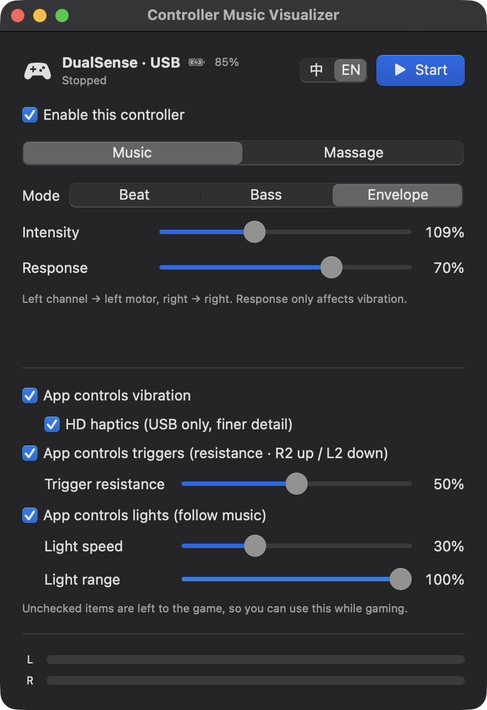

# Controller Music Visualizer

**手柄 · 震动 · 音乐可视化 · 触觉体验 · 手柄按摩 · PS5 / PS4 手柄 · Mac**

**Gamepad · Vibration · Music visualizer · Haptic experience · Controller massage · DualSense / DualShock 4 · macOS**

> **让吃灰的手柄，变成你感受音乐的新方式。**
> 插上（或蓝牙连上）一只索尼手柄，Mac 上正在播放的任何音乐，都能在手里**摸得到**（左右马达跟着节奏震动），在眼前**看得见**（灯条随乐器变色、白灯随音量跳动）。
>
> **Turn the controller gathering dust into a new way to experience music.**
> Connect a Sony controller over USB or Bluetooth, and whatever is playing on your Mac becomes something you can **feel** — the left and right motors pulse with the rhythm — and **see** — the light bar shifts color with the instruments and the white LEDs bounce with the volume.

适用于大部分索尼手柄：DualSense / DualSense Edge 支持全部功能，DualShock 4 等其他手柄也能用上震动（详见[支持的手柄](#支持的手柄--supported-controllers)）。跟随音乐之外，还内置按摩效果和扳机阻尼。

Works with most Sony controllers: DualSense / DualSense Edge get every feature, and DualShock 4 and other controllers still get vibration (see [Supported controllers](#支持的手柄--supported-controllers)). Beyond music, it also has massage patterns and adaptive-trigger resistance.

<p align="center"></p>

---

## 功能 · Features

| 中文 | English |
|---|---|
| **跟随音乐震动**：旁听系统正在播放的声音（不影响原有播放），左声道驱动左马达、右声道驱动右马达 | **Music-driven vibration**: listens to system audio (without affecting playback); left channel → left motor, right → right |
| 三种震动模式：**节拍**（鼓点脉冲）、**低音**（跟随低频起伏）、**包络**（跟随整体音量起伏） | Three modes: **Beat** (pulses on drum hits), **Bass** (follows low frequencies), **Envelope** (follows overall loudness) |
| **按摩**：揉捏、敲击、拍打、指压、波浪、心跳、渐强、滚压、持续、捶背、按摩枪、呼吸、雨滴 13 种预设，外加**随机轮播**（每 8–14 秒换一种，交叉过渡） | **Massage**: 13 presets — Knead, Tap, Pat, Shiatsu, Wave, Heartbeat, Crescendo, Roll, Steady, Pound, Gun, Breathe, Rain — plus **Random**, which rotates through them every 8–14 s with crossfades |
| **HD 震动（USB）**：像 PS5 一样用波形驱动马达。跟随音乐时把底鼓、贝斯的真实波形传到手上；按摩时每种预设有不同的频率质感 | **HD haptics (USB)**: drives the actuators with waveforms like a PS5. In Music mode the real kick/bass waveform reaches your hands; each massage preset has its own frequency texture |
| **扳机阻尼**：L2/R2 可调阻力，App 在后台时依然有效 | **Trigger resistance**: adjustable L2/R2 resistance that keeps working while the app is in the background |
| **扳机调强度**：按 R2 加强、L2 减弱，按得越深变得越快 | **Trigger intensity control**: hold R2 to increase, L2 to decrease; deeper press = faster change |
| **边玩游戏边用**：震动、扳机、灯光可以分别交给游戏或由 App 控制。比如游戏保留自己的自适应扳机和灯光，App 只负责跟随游戏声音震动 | **Use it while gaming**: vibration, triggers and lights can each be left to the game or controlled by the app — e.g. keep the game's adaptive triggers and lights while the app adds vibration that follows the game's audio |
| **灯条**：低/中/高频混合成红/绿/蓝，亮度跟随低音节奏，暗下去之后才换色 | **Light bar**: low/mid/high frequencies mixed into red/green/blue, brightness pulses with the bass, color changes only after it dims |
| **白点电平灯**：下方 5 颗白灯显示左右声道的相对强度 | **Player LEDs**: the 5 white LEDs act as a stereo level meter |
| **多手柄同时震动**：同时连多个手柄，各自独立设置（例如 DualSense 跟随音乐、8BitDo 同时按摩）；插拔时自动识别，记住每个手柄的设置 | **Multiple controllers at once**: connect several controllers, each with its own settings (e.g. DualSense follows the music while an 8BitDo runs a massage); hot-plug is detected and each controller's settings are remembered |
| USB 和蓝牙都支持；显示手柄电量和充电状态；界面中英文切换 | Works over USB and Bluetooth; shows controller battery and charging state; Chinese / English UI |

## 支持的手柄 · Supported controllers

| 手柄 · Controller | 支持情况 · Support |
|---|---|
| **DualSense（PS5）**、**DualSense Edge** | ✅ 全部功能：震动、扳机阻尼、灯条、白点电平灯，App 在后台也有效；USB / 蓝牙均可，**HD 震动仅 USB** · ✅ Everything: vibration, trigger resistance, light bar, player LEDs — also while the app is in the background; USB or Bluetooth, **HD haptics over USB only** |
| 以索尼 DualSense 身份被系统识别的兼容手柄 · Third-party controllers that identify as a Sony DualSense | ✅ 与 DualSense 相同 · ✅ Same as DualSense |
| **DualShock 4（PS4）** 及其他 macOS 能识别、支持震动的手柄 · **DualShock 4 (PS4)** and other controllers macOS recognizes with rumble | ⚠️ 基本功能：通过 GameController 震动；DualShock 4 的灯条在 App 位于前台时可变色；没有扳机阻尼和白点电平灯 · ⚠️ Basics: vibration via GameController; the DualShock 4 light bar changes color while the app is in the foreground; no trigger resistance or player LEDs |
| **8BitDo Lite 2**（S 模式，即 Switch 模式） · **8BitDo Lite 2** (S / Switch mode) | ⚠️ 已实测：被识别为 Switch Pro 手柄，能震动（左右分开），力度偏弱（小转子马达）；没有灯条和扳机效果。其他模式下 macOS 无法让它震动 · ⚠️ Tested: recognized as a Switch Pro Controller; vibration works (left/right separately) but is weak (small rotating motors); no light bar or trigger effects. In its other modes macOS can't drive its rumble |

> 已实测：DualSense（USB 和蓝牙）、8BitDo Lite 2（S 模式）。其他手柄按代码逻辑应可使用，但尚未逐一实测，欢迎反馈。
> Tested: DualSense over USB and Bluetooth, 8BitDo Lite 2 in S mode. Other controllers should work according to the code paths but haven't each been tested — feedback welcome.

## 环境要求 · Requirements

- macOS 14.2 或更高版本（系统声音采集接口需要）· macOS 14.2 or later (required for the system-audio tap API)
- 一只索尼手柄（推荐 DualSense / DualSense Edge），USB 或蓝牙连接 · A Sony controller (DualSense / DualSense Edge recommended), connected via USB or Bluetooth
- Xcode 命令行工具（Swift 5.10+）· Xcode Command Line Tools (Swift 5.10+)

## 编译运行 · Build & Run

```bash
git clone https://github.com/liuwengood123gmail/controller-music-visualizer.git
cd controller-music-visualizer
./build.sh
open build/ControllerMusicVisualizer.app
```

`build.sh` 会编译并打包成 `build/ControllerMusicVisualizer.app`。本机有 Apple Development 证书时会用它签名（这样重新编译后系统录音权限不会丢失），否则使用临时签名。

`build.sh` compiles the app and packages it as `build/ControllerMusicVisualizer.app`. If an Apple Development certificate is available it is used for signing (so the audio permission survives rebuilds); otherwise the app is ad-hoc signed.

单元测试（不需要手柄）：`swift test`。每次推送都会由 GitHub Actions 在 macOS 上自动编译并运行测试。· Unit tests (no controller needed): `swift test`. GitHub Actions builds and runs the tests on macOS for every push.

## 使用方法 · Usage

1. **连接手柄** · **Connect the controller**
   - USB：插上数据线即可。· USB: just plug it in.
   - 蓝牙：首次配对时同时按住 **Create** 和 **PS** 键约 3–5 秒，灯条快速双闪后，在「系统设置 → 蓝牙」里连接。之后按一下 PS 键即可重连。· Bluetooth: for first-time pairing, hold **Create** + **PS** for 3–5 s until the light bar double-flashes, then connect in System Settings → Bluetooth. Afterwards, press PS to reconnect.
2. **选择手柄**：连了多个手柄时，在左上角的下拉框里选择要设置的手柄，下方显示的就是它自己的设置；不想让 App 控制某个手柄，就取消它的「启用这个手柄」。· **Pick a controller**: with several controllers connected, choose one in the drop-down at the top left — the settings below belong to that controller. Uncheck *Enable this controller* to leave one alone.
3. **点「开始」**（或按空格键），所有已启用的手柄一起开始。· **Press Start** (or the space bar) to start all enabled controllers.
4. **首次使用「跟随音乐」**会请求「系统录音」权限，点「允许」。弹窗可能出现在另一块显示器上。如果错过了，可在「系统设置 → 隐私与安全性 → 录屏与系统录音」里打开。· **The first time you use Music mode**, macOS asks for *System Audio Recording* permission — click Allow. The dialog may appear on another display. If you missed it, enable the app in System Settings → Privacy & Security → Screen & System Audio Recording.

### 控制项说明 · Controls

| 控制项 | 作用 | Control | What it does |
|---|---|---|---|
| 手柄下拉框 | 选择要设置的手柄（名称 · 连接方式 · 电量）；只有一个手柄时直接显示名称 | Controller menu | Chooses which controller you're editing (name · connection · battery); shows just the name when only one is connected |
| 启用这个手柄 | 取消后 App 完全不碰这个手柄 | Enable this controller | Off = the app leaves this controller alone |
| 强度 | 0–300%。超过 100% 会抬高弱震动，但强弱对比会变小 | Intensity | 0–300%. Above 100% lifts weak vibration but reduces contrast |
| 响应速度 | 震动跟随声音的快慢（尤其是声音变小时） | Response | How quickly vibration follows the audio (especially when it gets quieter) |
| 鼓点灵敏度 | 仅节拍模式：越高，越小的鼓点也会触发 | Beat sensitivity | Beat mode only: higher = softer hits also trigger |
| 速度 | 按摩节奏快慢 | Speed | Massage tempo |
| App 控制震动 | 取消后震动交给游戏（等于 App 不碰马达） | App controls vibration | Off = vibration is left to the game |
| └ HD 震动 | 仅 USB：用波形驱动马达，更细腻；关闭则用兼容震动 | └ HD haptics | USB only: waveform-driven, finer detail; off = compatible rumble |
| App 控制扳机 | 取消后扳机交给游戏：不设阻尼，R2/L2 也不再调强度 | App controls triggers | Off = triggers are left to the game: no resistance, and R2/L2 no longer adjust intensity |
| └ 扳机阻尼 | L2/R2 阻力，0 为关闭 | └ Trigger resistance | L2/R2 resistance; 0 = off |
| App 控制灯光 | 取消后灯条和白灯交给游戏 | App controls lights | Off = light bar and player LEDs are left to the game |
| └ 灯条速度 | 灯条暗下去的快慢：慢像呼吸灯，快则一闪一闪；也决定换色频率 | └ Light speed | How fast the light bar dims: slow = breathing, fast = flashing; also sets how often colors change |
| └ 灯条起伏 | 亮暗变化幅度：100% 时鼓点间完全暗掉，越低保留的底亮度越高 | └ Light range | Depth of the pulsing: 100% = fully dark between beats, lower keeps a base glow |

以上设置都是**每个手柄各自一份**，App 会按手柄记住；新手柄第一次连上时，复制当前选中手柄的设置。设置项会按手柄能力显示：没有灯条的手柄不显示灯光设置，非 DualSense 不显示扳机阻尼，只有 USB 连接的 DualSense 显示 HD 震动。· All of these are **per controller** and remembered per controller; a controller connecting for the first time copies the settings of the one currently selected. Options follow each controller's capabilities: no light bar → no light settings, non-DualSense → no trigger resistance, HD haptics only for a USB-connected DualSense.

**建议 · Tips**：想要「跟得紧、强弱明显」，选低音或包络模式，响应速度 90–100%，强度 100% 左右。· For tight, punchy vibration, use Bass or Envelope mode, Response at 90–100%, Intensity around 100%.

**边玩游戏边用 · While gaming**：选「跟随音乐 → 低音」，它会跟着游戏音效（爆炸、引擎、枪声）震动；取消「App 控制扳机」，保留游戏的自适应扳机，也避免开枪、踩油门时误改强度；想要游戏自己的灯光就取消「App 控制灯光」。三项都取消就等于停止。· Use Music → Bass so vibration follows game sound effects (explosions, engines, gunfire); turn off *App controls triggers* to keep the game's adaptive triggers and avoid changing intensity when you pull the triggers; turn off *App controls lights* to keep the game's lighting. Turning all three off is the same as stopping.

> 已实测：「App 控制震动」取消、灯光由 App 控制时，其他程序通过系统接口发出的震动（与游戏相同的路径）正常工作，灯条同时继续跟随音乐。
> Tested: with *App controls vibration* off and lights controlled by the app, rumble sent by another program through the system API (the same path games use) works normally while the light bar keeps following the music.

## 设计思路 · Design

### 整体结构 · Architecture

```
System audio ─► SystemAudioTap ─► MusicAnalyzer ─► raw features (shared, one per app)
 (listen-only)                          │              │
                                        │              ▼  every 10 ms (AppModel)
                                        │              ┌─ ControllerSession A (DualSense) ─ VibrationShaper / LightShaper / MassagePreset
                                        │              │     ├─► DualSenseHID ─► rumble, triggers, lights (HID reports)
                                        ▼              │     └─► HDHapticOutput ─► USB audio ch 3/4 (HD haptics)
                                 HapticWaveform ───────│─────────┘ (HD reads the shared waveform)
                                                       └─ ControllerSession B (e.g. 8BitDo)
                                                             └─► RumbleHapticOutput ─► GameController / CoreHaptics

ControllerRegistry: discovers controllers (HID + GameController), hot-plug, identity, remembered settings
```

系统声音只采集、分析一份，得到的原始特征交给每个手柄的会话（`ControllerSession`）：会话按自己的设置做平滑、鼓点判定、灯条换色，再通过各自的输出通道发给手柄。DualSense 走 HID 报告（USB 时震动走 HD 音频声道，读取共享的音乐低频波形）；其他手柄走 GameController。`AppModel` 每 10ms 驱动一次所有会话，`ControllerRegistry` 负责发现手柄、处理插拔、识别身份和记住设置。多手柄的完整设计见 [docs/multi-controller-design.md](docs/multi-controller-design.md)。

System audio is captured and analyzed once; the raw features go to every controller's session (`ControllerSession`), which applies its own smoothing, beat detection and light-bar color logic and drives its own outputs. A DualSense uses HID reports (over USB, vibration goes through the HD audio channels and reads the shared low-frequency music waveform); other controllers use GameController. `AppModel` ticks all sessions every 10 ms, and `ControllerRegistry` discovers controllers, handles hot-plug, identifies them and remembers their settings. The full multi-controller design is in [docs/multi-controller-design.md](docs/multi-controller-design.md).

| 文件 · File | 职责 · Responsibility |
|---|---|
| `SystemAudioTap.swift` | 用 Core Audio process tap 旁听整机声音（`muteBehavior = unmuted`，不影响播放）· Listens to all system audio via a Core Audio process tap (unmuted; playback is untouched) |
| `MusicAnalyzer.swift` | 滤波、相对强度、灯光特征，只输出原始特征（所有手柄共用）· Filtering, relative loudness, light features; outputs raw features shared by all controllers |
| `MassagePatterns.swift` | 按摩波形、颜色、HD 频率范围，随机轮播 · Massage waveforms, colors, HD frequency ranges, random rotation |
| `DualSenseHID.swift` | 枚举 DualSense、发送 HID 输出报告（USB 0x02 / 蓝牙 0x31 + CRC32）、读取输入报告 · Enumerates DualSense controllers, sends raw HID output reports (USB 0x02 / Bluetooth 0x31 + CRC32), reads input reports |
| `HDHaptics.swift` | 音乐低频波形缓冲 + 手柄音频输出：第 3/4 声道 = HD 震动，第 1/2 声道 = 手柄扬声器（同一个 AUHAL、同一个读位置）· Music low-frequency waveform buffer + controller audio output: channels 3/4 = HD haptics, channels 1/2 = controller speaker (one AUHAL, one read cursor) |
| `SpeakerDSP.swift` / `Latency.swift` | 扬声器的单声道高通缓冲、音量/限幅/渐变、读位置游标与自适应余量、延迟模型和可调参数 · Speaker mono high-pass feed, volume/limiter/fade, read cursor with adaptive margin, latency model and tuning parameters |
| `HapticEngines.swift` | 后备方案：GameController + CoreHaptics · Fallback path: GameController + CoreHaptics |
| `AppModel.swift` | 全局开始 / 停止、10ms 主循环、系统声音采集的启停 · Global start/stop, 10 ms main loop, starting/stopping audio capture |
| `ControllerRegistry.swift` / `ControllerIdentity.swift` | 发现手柄、插拔、身份识别（DualSense 用 HID LocationID / 序列号，并与音频设备 UID 对应）· Controller discovery, hot-plug, identity (DualSense by HID LocationID / serial, matched to its audio device UID) |
| `ControllerSession.swift` | 单个手柄：输出通道、扳机、震动、灯光、按摩时间 · One controller: outputs, triggers, vibration, lights, massage clock |
| `ControllerSettings.swift` | 每个手柄的设置，按身份保存到 UserDefaults · Per-controller settings, saved to UserDefaults by identity |
| `Shaping.swift` | 每个会话独立的震动平滑 / 鼓点判定、灯条锁色、白灯电平 · Per-session vibration smoothing / beat detection, light-bar color latching, player-LED meter |
| `DualSenseReport.swift` | HID 输出报告的构造与输入报告（扳机、电量）的解析，纯函数便于测试 · Builds HID output reports and parses input reports (triggers, battery); pure functions for testing |
| `App.swift` / `Localization.swift` | SwiftUI 界面、中英文切换 · SwiftUI UI and Chinese/English switching |

### 为什么直接发 HID 报告 · Why raw HID reports

- macOS 只允许**前台** App 通过 GameController 设置扳机阻尼和灯条；App 进入后台后系统会重置它们，并用自己的输出报告不断覆盖。直接向手柄发送 HID 输出报告可以绕开这个限制，前台后台效果一致。
- macOS only lets the **foreground** app set trigger effects and the light bar through GameController; when the app goes to the background the system resets them and keeps overwriting them. Sending HID output reports directly avoids this, so behavior is the same in the foreground and background.
- 震动、扳机、灯条、白灯合在一份报告里发送；状态不变时每 0.1 秒重发一次，盖掉系统的重置。报告格式参考 Linux `hid-playstation` 驱动。
- Rumble, triggers, light bar and player LEDs share one report; it is resent every 0.1 s even when unchanged to override system resets. The report layout follows the Linux `hid-playstation` driver.
- 如果打不开 HID 设备，会退回 GameController + CoreHaptics（注意：手柄的震动服务不支持 `CHHapticAdvancedPatternPlayer`，只能用普通 player 加动态参数）。
- If the HID device can't be opened, the app falls back to GameController + CoreHaptics (note: the controller haptics service rejects `CHHapticAdvancedPatternPlayer`, so a plain player with dynamic parameters is used).

### HD 震动 · HD haptics

| 中文 | English |
|---|---|
| DualSense 的马达是音圈马达，支持两种驱动方式：**HD 震动**（直接送波形，能表现频率和质感）和**兼容震动**（只给左右各一个 0–255 的强度，固件模拟 PS4 的转子马达手感） | The DualSense uses voice-coil actuators that can be driven two ways: **HD haptics** (raw waveforms, with frequency and texture) and **compatible rumble** (one 0–255 strength per side; the firmware imitates PS4 rotating motors) |
| USB 连接时手柄是一个 4 声道音频设备，第 3/4 声道驱动左/右马达。但只要 HID 输出报告里的兼容震动开关（flag0 的 bit0、bit1，以及新固件 flag2 的 bit2）还开着，手柄就会忽略这两个声道。macOS 的系统手柄服务一直让它们开着，所以默认用不了 HD | Over USB the controller is a 4-channel audio device and channels 3/4 drive the left/right actuators. But as long as the compatible-rumble bits in the HID output report (flag0 bits 0–1, plus flag2 bit 2 on newer firmware) are set, the controller ignores those channels — and the macOS controller service keeps them set, so HD is unavailable by default |
| 本项目自己发送 HID 报告并关掉这些开关，再向第 3/4 声道输出波形，就在 Mac 上实现了 HD 震动；停止时恢复兼容模式，不影响其他游戏和 App | This project sends its own HID reports with those bits cleared and writes waveforms to channels 3/4, enabling HD haptics on the Mac; it restores compatible mode on stop so other games and apps are unaffected |
| **跟随音乐**：取音乐 300Hz 以下的波形（底鼓、贝斯），按包络归一成单位幅度，再软饱和推高平均力度。左右声道分开；强弱仍由节拍/低音/包络模式决定，低频不足时混入正弦载波 | **Music**: the waveform below 300 Hz (kick, bass) is normalized by its envelope and soft-saturated to raise its average strength. Left/right are kept separate; the Beat/Bass/Envelope mode still sets the dynamics, with a sine carrier blended in when there's little low end |
| 系统声音和手柄是两个独立时钟的音频设备，中间用环形缓冲把延迟维持在约 20ms | System audio and the controller are separate audio devices with independent clocks; a ring buffer keeps the latency around 20 ms |
| **频率随强度变化**：实测马达在 **50–65Hz** 最有劲（比兼容震动的最大值还强），低于 50Hz 反而变弱。所以正弦载波的频率随震动强度变化：弱时用较高频率（细腻），强时降到 50–55Hz（有劲），不低于 50Hz；每种音乐模式和按摩预设有自己的频率范围 | **Frequency follows intensity**: the actuators are strongest at **50–65 Hz** (stronger than compatible rumble at max) and get weaker below 50 Hz. So the sine carrier's frequency tracks intensity — higher when soft (finer), down to 50–55 Hz when strong (punchier), never below 50 Hz — with a range per music mode and massage preset |
| **蓝牙 HD**：PS5 通过蓝牙用私有的 0x32 报告传输 3kHz 8 位波形（见 [SAxense](https://github.com/egormanga/SAxense)）。我们在 macOS 上试过：报告能发出去，但每次发送阻塞约 26–30ms，只能达到需要速率（约 94 包/秒）的三分之一，手柄没有震动，所以蓝牙仍使用兼容震动 | **Bluetooth HD**: over Bluetooth the PS5 streams 3 kHz 8-bit waveforms in a proprietary 0x32 report (see [SAxense](https://github.com/egormanga/SAxense)). We tried it on macOS: the reports go out, but each send blocks for ~26–30 ms, reaching only a third of the required rate (~94 packets/s), and the controller didn't vibrate — so Bluetooth stays on compatible rumble |

### 相对强度 · Relative loudness

- 流行音乐混音时整体音量被压得很平，如果拿「当前音量 / 最近最大值」来驱动，响的歌会一直满格。
- Modern masters are heavily compressed; driving output by "current / recent peak" keeps loud songs pinned at full.
- 所以震动（低音/包络模式）和白点都使用 `RelativeLevel`：按分贝记住近 2 秒的最小、最大音量，把当前音量映射到两者之间；两端至少相差 6dB，避免微小波动被放大。
- So vibration (Bass/Envelope) and the player LEDs use `RelativeLevel`: it tracks the min and max loudness (in dB) over ~2 s and maps the current level between them, with at least 6 dB of range so tiny fluctuations aren't amplified.

### 灯条 · Light bar

参考了 [audio-reactive-led-strip](https://github.com/scottlawsonbc/audio-reactive-led-strip) 的 energy 效果。· Inspired by the *energy* effect in [audio-reactive-led-strip](https://github.com/scottlawsonbc/audio-reactive-led-strip).

| 中文 | English |
|---|---|
| **颜色**：低频（<250Hz，底鼓/贝斯）→ 红，中频（250–2500Hz，人声/吉他）→ 绿，高频（>2500Hz，镲片）→ 蓝，按能量混合。每段按自己的峰值归一，并去掉一部分共同成分来提高饱和度 | **Color**: low (<250 Hz, kick/bass) → red, mid (250–2500 Hz, vocals/guitar) → green, high (>2500 Hz, cymbals) → blue, mixed by energy. Each band is normalized to its own peak, and part of the common component is removed to boost saturation |
| **亮度**：跟随低音起伏，减去近期底线后放大，鼓点间会暗下去 | **Brightness**: follows the bass envelope minus a recent floor, so it dims between beats |
| **离散换色**：亮着时颜色锁定；亮度低于 12% 算「暗了」，重新超过 25% 时按当时的声音成分选新颜色。慢速下如果连续亮了 2 秒，就在下一个亮度波谷换色 | **Discrete color changes**: the color is locked while lit; it is re-picked from the current sound only after brightness drops below 12% and rises above 25% again. At slow speeds, if it stays lit for 2 s, the color changes at the next brightness trough |

我们也试过「按音色重心」「按最突出频段」「按和弦识别」来定颜色：前两者让人感觉不到和音乐的关系，和弦识别则有 0.5 秒以上的延迟且实时识别不够准，最终选择了上面这种低延迟、能直观对应声音的方式。

We also tried coloring by spectral centroid, by the most prominent band, and by real-time chord recognition. The first two didn't feel connected to the music, and chord recognition lagged by 0.5 s or more and wasn't reliable in real time, so we settled on the low-latency, intuitive mapping above.

## 已知限制 · Known limitations

- 触控板两侧的灯条是同一颗 RGB 灯，无法分别显示左右声道。· The light bar on both sides of the touchpad is a single RGB LED, so it can't show left and right channels separately.
- HD 震动只支持 USB；蓝牙连接时是兼容震动（只能调强弱）。· HD haptics work over USB only; over Bluetooth vibration is compatible rumble (intensity only).
- 系统音量键不影响震动：采集到的是系统调音量之前的声音。· The system volume doesn't affect vibration: the tap captures audio before system volume is applied.

## 其他 · Misc

- `dualsense_test.swift`：最早用来测试手柄按键、震动、灯条、自适应扳机的命令行小工具（`swiftc -swift-version 5 dualsense_test.swift -o dualsense_test && ./dualsense_test`）。· A small CLI tool from early development that tests buttons, rumble, light bar and adaptive triggers.
- 调试参数：`open build/ControllerMusicVisualizer.app --args --autostart`（启动后自动开始）、`--massage`（新手柄默认按摩页）、`--select <序号>`（打开时选中第几个手柄，从 0 开始）。· Debug flags: `--autostart` (start on launch), `--massage` (new controllers open on the Massage tab), `--select <n>` (select the n-th controller on launch, 0-based).
- 设计文档：[docs/multi-controller-design.md](docs/multi-controller-design.md)（多手柄）、[docs/controller-speaker-design.md](docs/controller-speaker-design.md)（手柄扬声器同步播放）。· Design docs: [multi-controller](docs/multi-controller-design.md), [controller speaker](docs/controller-speaker-design.md).
- 手柄扬声器同步播放（仅 USB DualSense，默认关、音量 30%）的可调参数，用 `defaults write com.liuliu.ControllerMusicVisualizer <键> <值>` 修改，重启 App 生效；`defaults delete` 恢复默认。窗口里打开该功能后会显示估算延迟和缓冲状态。· Tuning for the controller speaker (USB DualSense only; off by default, 30% volume): set with `defaults write com.liuliu.ControllerMusicVisualizer <key> <value>` and restart; `defaults delete` restores defaults. The window shows the estimated delay and buffer stats while it is on.

  | 键 · Key | 含义 · Meaning | 默认 · Default |
  |---|---|---|
  | `speaker.hwVolume` | 扬声器硬件音量 61–100（0x3d–0x64，低于范围等于静音）· hardware volume 61–100 | 100 |
  | `speaker.preamp` | 扬声器前置放大 0–7 · speaker preamp 0–7 | 0 |
  | `speaker.highpassHz` | 高通截止频率 · high-pass cutoff (Hz) | 200 |
  | `speaker.bufferMs` | 环形缓冲目标余量（毫秒）；不设置 = 按块大小自动计算并自适应 · ring-buffer margin (ms); unset = automatic and adaptive | 自动 · auto |
  | `speaker.ioFrames` | DualSense 输出的 IO 缓冲帧数 · DualSense output IO buffer frames | 256 |
  | `speaker.tapFrames` | 系统声音采集的 IO 缓冲帧数 · system-audio tap IO buffer frames | 256 |
  | `speaker.hapticsDelayMs` | 兼容震动相对扬声器的对齐延迟（毫秒，可为负：负值改为延迟扬声器）；不设置 = 按延迟模型估算 · alignment delay of compatible vibration vs. the speaker (ms; negative delays the speaker instead); unset = estimated | 自动 · auto |
